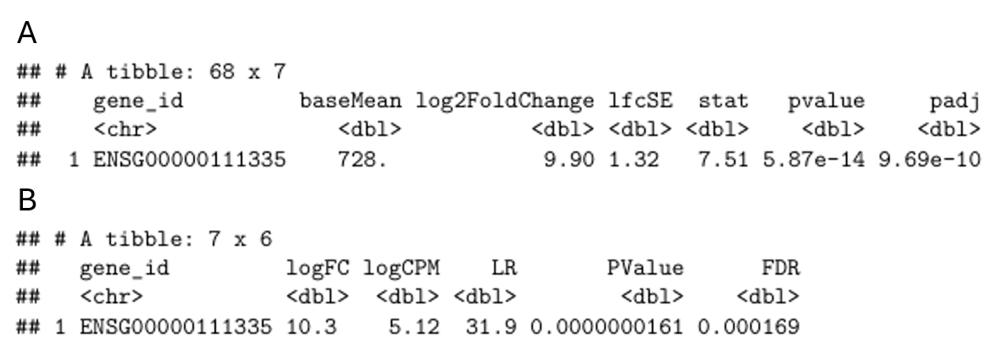
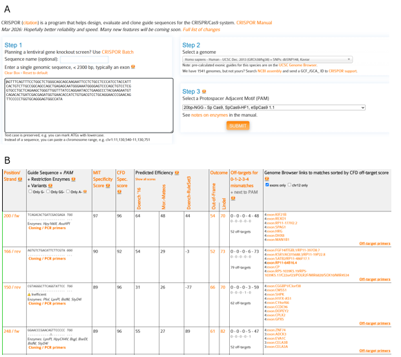

# Task 2: gRNA design for OAS2

## Target gene selection

Task 1 identified six genes that were significant in both DESeq2 and edgeR. For Task 2, we selected **OAS2** (`ENSG00000111335`) as the target gene. OAS2 was one of the strongest consensus genes in our analysis and showed a large increase in expression in the SARS condition. OAS2 is also biologically relevant because it is part of the interferon-induced antiviral response and contributes to RNase L activation after sensing viral double-stranded RNA [@merold2025]. OAS family genes have also been associated with severe COVID-19 and COVID-19-related heart failure [@gao2023; @hernandezramirez2026].

Within the project scenario, this made OAS2 a reasonable gene to continue with for CRISPR-based regulation.

{#fig-oas2-de width="85%"}

As shown in @fig-oas2-de, OAS2 had a DESeq2 log2 fold change of **9.90** and an edgeR logFC of **10.3**. Both values are positive, showing strong upregulation in the SARS samples compared with mock.

## Choice of CRISPR strategy

The project hypothesis is that restoring deregulated gene expression may improve recovery. Because OAS2 was strongly upregulated, we selected **CRISPR interference (CRISPRi)** rather than CRISPR activation. CRISPRi uses catalytically inactive Cas9 together with a transcriptional repressor such as KRAB to reduce transcription. Targeting close to the transcription start region is commonly used for efficient CRISPRi regulation [@jensen2021].

The project requires the guide RNA to target the **first exon** of the selected gene. We therefore used the first exon of the OAS2 MANE Select transcript for guide design.

## OAS2 transcript and first exon

The OAS2 gene was inspected in Ensembl to identify its transcript structure. OAS2 is located on the forward strand of chromosome 12. We selected the **MANE Select transcript `ENST00000392583.7`**, which provides a representative transcript agreed between NCBI and EMBL-EBI [@morales2022]. The first exon used for guide design was `ENSE00002421397.2`.

{#fig-oas2-ensembl width="78%"}

The 267 bp first-exon sequence was downloaded in FASTA format and used as the input sequence for guide design.

::: {.callout-note collapse="true"}
## First exon sequence used for CRISPOR

`>ENSE00002421397.2 gene:ENSG00000111335.15 transcript:ENST00000392583.7 exon:1 total_exons:10`

``` text
AGTTTCAGTTTCCTGGCTCTGGGCAGCAGCAAGAATTCCTCTGCCTCCCATCCTACCATTCACTGTCTTGCCGGCAGCCAGCTGAGAGCAATGGGAAATGGGGAGTCCCAGCTGTCCTCGGTGCCTGCTCAGAAGCTGGGTTGGTTTATCCAGGAATACCTGAAGCCCTACGAAGAATGTCAGACACTGATCGACGAGATGGTGAACACCATCTGTGACGTCCTGCAGGAACCCGAACAGTTCCCCCTGGTGCAGGGAGTGGCCATA
```
:::

## Guide design tool

Several guide-design tools are available, including SSC, E-CRISP, CHOPCHOP and CRISPOR [@li2023; @cui2018]. We selected **CRISPOR** because it reports both predicted on-target efficiency and off-target specificity, gives genomic locations for predicted off-target sites, supports the human GRCh38 reference genome, and allows the results to be downloaded for later analysis [@concordet2018]. These features are useful for both Task 2 and Task 3.

For the CRISPOR search, we used:

-   **Reference genome:** Human GRCh38
-   **Target sequence:** first exon of OAS2
-   **Nuclease:** SpCas9
-   **PAM:** NGG
-   **Guide length:** 20 bp protospacer

{#fig-crispor width="95%"}

CRISPOR returned several SpCas9-compatible guides within the first exon. We compared the candidates using both predicted efficiency and specificity rather than choosing a guide from only one score.

## Selected guide RNAs

Two guides were selected because they gave a good balance between predicted activity and specificity.

| Guide | Position | Protospacer (5'--3') | PAM | Specificity score | Highest efficiency score | Predicted off-targets | Closest off-targets |
|---------|--------:|---------|:-------:|--------:|--------:|--------:|---------|
| gRNA 1 | 200/fw | `TCAGACACTGATCGACGAGA` | TGG | 97 | 64 | 52 | at least 3 mismatches |
| gRNA 2 | 248/fw | `GGAACCCGAACAGTTCCCCC` | TGG | 89 | 89 | 52 | at least 3 mismatches |

The first guide had the higher specificity score, while the second guide had the higher predicted efficiency. For both guides, CRISPOR reported 52 possible off-target sites. All reported off-target sites had **three or more mismatches**, and no perfect or near-perfect off-target match was reported in the CRISPOR output. This suggests that both guides have good predicted specificity, although these predictions still need to be considered together with individual genetic variation in Task 3.

## Preparation for Task 3

The complete CRISPOR guide table and the detailed off-target lists were downloaded. These files contain the guide scores and genomic coordinates needed for the next stage of the project. In Task 3, the selected guides can therefore be checked against genetic variation in individual genomes to determine whether variants change the target sequence or alter possible off-target sites.

## Task 2 conclusion

OAS2 was selected from the Task 1 consensus genes because it showed strong and consistent upregulation and has a clear antiviral function. CRISPRi was selected to reduce its expression. The first exon of the MANE Select transcript was analysed with CRISPOR using the GRCh38 reference genome and SpCas9-NGG settings. Two candidate guides were selected based on their predicted efficiency and specificity. These guides will be carried forward to Task 3 for variant-aware evaluation.
