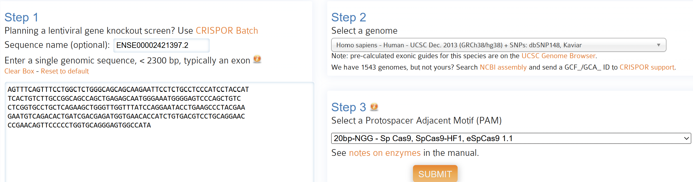
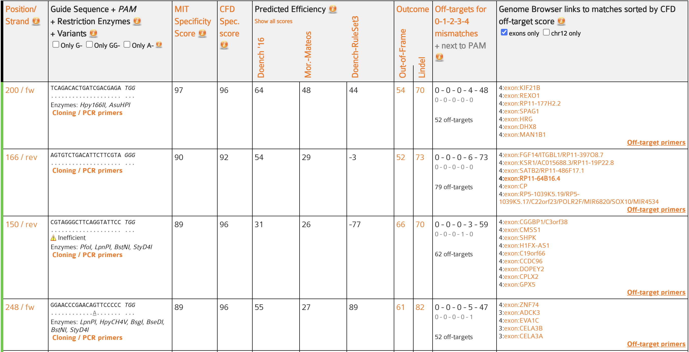

# Task 2: gRNA design for OAS2

```{r task2-setup}
#| include: false
library(tidyverse)
library(knitr)

consensus_table <- readRDS("data/consensus_table.rds")
```

## Target gene selection

Task 1 identified six genes that were significant in both DESeq2 and edgeR. Both methods also agreed on the direction of the expression change. The six consensus genes are shown in @tbl-consensus.

For Task 2, we selected **OAS2** (`ENSG00000111335`). OAS2 showed a strong increase in expression in the SARS condition with both differential-expression methods. It also has a clear role in the human antiviral response. OAS2 is part of the interferon-induced OAS pathway and contributes to activation of RNase L after viral double-stranded RNA is detected [@merold2025]. OAS family genes have also been linked to severe COVID-19 and COVID-19-related heart failure [@gao2023; @hernandezramirez2026].

The Task 1 result for OAS2 is summarised in @tbl-oas2-de.

```{r tbl-oas2-de}
#| echo: false
#| tbl-cap: "Differential-expression results for OAS2 from Task 1."

consensus_table |>
  filter(gene_name == "OAS2") |> 
  select(fold_change_deseq, adj_p_value_deseq, fold_change_edger, adj_p_value_edger) |> 
  pivot_longer(
    cols = everything(),
    names_to = c(".value", "Method"),
    names_pattern = "(.*)_(deseq|edger)"
  ) |> 
  mutate(
    Method = recode_values(
      Method,
      "deseq" ~ "DESeq2",
      "edger" ~ "edgeR-LRT"
    )
  ) |> 
  dplyr::rename(
    `Fold change` = fold_change,
    `Adjusted p-value / FDR` = adj_p_value
  ) |> 
  kable(
    digits = 3,
    align = c("l", "r", "r")
  )
```

OAS2 had a DESeq2 log2 fold change of **9.90** and an edgeR logFC of **10.30**, with adjusted values of **9.69e-10** and **0.000169**, respectively. Both methods support increased expression in SARS compared with mock. The table's "Fold change" column contains log2 values, not expression ratios. The low mock counts and two-donor design limit the interpretation of the size of this change.

## Choice of CRISPR strategy

The project hypothesis is that restoring deregulated gene expression may improve recovery. Because OAS2 was upregulated, we selected **CRISPR interference (CRISPRi)** to reduce transcription. CRISPRi uses catalytically inactive Cas9 with a repressor such as KRAB [@jensen2021]. This follows the direction-based choice in the project brief. OAS2 also has an antiviral role, so increased expression does not by itself show that repression would be beneficial [@merold2025].

The project asks for guides within the **first exon**. We therefore used the first exon of the OAS2 MANE Select transcript. This meets the project's target-region requirement; it does not establish that these sites give the strongest CRISPRi repression.

## OAS2 transcript selection

OAS2 was inspected in Ensembl using the human **GRCh38.p14** reference assembly. The gene is located on chromosome 12 and is on the forward strand.

The **MANE Select transcript `ENST00000392583.7`** was selected. MANE provides a representative transcript that is matched between NCBI and EMBL-EBI [@morales2022].

{#fig-oas2-ensembl width="95%"}

## Selection of the first exon

The MANE Select transcript contains 10 exons. The first exon is **`ENSE00002421397.2`**. It is located at `chr12:112,978,519-112,978,785`, is on the forward strand, and has a length of **267 bp**.

{#fig-oas2-first-exon width="95%"}

The first-exon sequence was copied from Ensembl and used as the input sequence for CRISPOR.

::: {.callout-note collapse="true"}
## First exon sequence used for CRISPOR

`>ENSE00002421397.2 gene:ENSG00000111335.15 transcript:ENST00000392583.7 exon:1 total_exons:10`

``` text
AGTTTCAGTTTCCTGGCTCTGGGCAGCAGCAAGAATTCCTCTGCCTCCCATCCTACCAT
TCACTGTCTTGCCGGCAGCCAGCTGAGAGCAATGGGAAATGGGGAGTCCCAGCTGTC
CTCGGTGCCTGCTCAGAAGCTGGGTTGGTTTATCCAGGAATACCTGAAGCCCTACGAA
GAATGTCAGACACTGATCGACGAGATGGTGAACACCATCTGTGACGTCCTGCAGGAAC
CCGAACAGTTCCCCCTGGTGCAGGGAGTGGCCATA
```
:::

## Guide design with CRISPOR

Several guide-design tools are available, including SSC, E-CRISP, CHOPCHOP and CRISPOR [@li2023; @cui2018]. Lecture 6 separates guide assessment into efficiency at the intended site and specificity against other sites. We selected **CRISPOR** because it reports both types of prediction and provides downloadable off-target sequences and genomic locations for Task 3 [@concordet2018].

The CRISPOR analysis used the following settings:

-   **Reference genome:** Homo sapiens GRCh38/hg38
-   **Target sequence:** first exon of OAS2 (`ENSE00002421397.2`)
-   **Nuclease:** SpCas9
-   **PAM:** NGG
-   **Guide length:** 20 bp

{#fig-crispor-settings width="95%"}

After submitting the sequence, CRISPOR returned the SpCas9-compatible guides within the first exon. The output includes specificity scores, several predicted efficiency scores and predicted off-target sites.

{#fig-crispor-results width="100%"}

## Selected guide RNAs

Two guides were selected by considering predicted efficiency and specificity together. The first-exon sequence and an NGG PAM were required for both. We favoured candidates without reported off-targets at zero, one or two protospacer mismatches and then compared specificity and efficiency scores. Their main values are shown in @tbl-selected-guides.

```{r tbl-selected-guides}
#| echo: false
#| tbl-cap: "Selected OAS2 guide RNAs and CRISPOR prediction scores."

guide_table <- tribble(
  ~Guide, ~Position, ~Protospacer, ~PAM, ~`MIT specificity`, ~`CFD specificity`, ~`Doench 2016`, ~`Moreno-Mateos`, ~`RuleSet3`, ~`Predicted off-targets`,
  "gRNA 1", "200/fw", "TCAGACACTGATCGACGAGA", "TGG", 97, 96, 64, 48, 44, 52,
  "gRNA 2", "248/fw", "GGAACCCGAACAGTTCCCCC", "TGG", 89, 96, 55, 27, 89, 52
)

guide_table |>
  kable(
    align = c("l", "l", "l", "c", "r", "r", "r", "r", "r", "r")
  )
```

gRNA 1 (**200/fw**, called **200forw** in Task 3) had the higher MIT specificity score (**97**) and higher Doench 2016 and Moreno-Mateos scores (**64** and **48**). gRNA 2 (**248/fw**, or **248forw**) had the higher RuleSet3 score (**89**). Both had a CFD specificity score of **96**. We retained gRNA 1 for its stronger MIT score and gRNA 2 as an alternative supported by RuleSet3. The efficiency models disagree, so there is no single guide that is best under every displayed score.

CRISPOR reported **52 possible off-target sites** for each guide. For gRNA 1, the distribution was `0-0-0-4-48` for sites with 0, 1, 2, 3 and 4 mismatches; for gRNA 2 it was `0-0-0-5-47`. Neither has a reported perfect, one-mismatch or two-mismatch off-target in this search. gRNA 1 has one fewer three-mismatch site. As discussed in Lecture 6, counts alone are insufficient because mismatch position also affects recognition; the CFD model additionally accounts for mismatch type [@haeussler2016].

The displayed alternatives also support the choice. Compared with 166/rev, 200/fw has higher MIT and CFD specificity (97 versus 90 and 96 versus 92) and fewer reported off-targets (52 versus 79). The 150/rev candidate is marked "Inefficient" and has lower Doench 2016 and RuleSet3 values than 248/fw (31 versus 55 and -77 versus 89). These comparisons support retaining the selected pair for Task 3.

These scores are predictions, not measured success rates. Values should be compared within the same scoring model rather than averaged across models. CRISPOR's cleavage-based predictions do not directly measure CRISPRi repression. Both guides therefore remain candidates that require individual sequence checks and experimental validation.

## Preparation for Task 3

The selected guides and their off-target information are carried forward to Task 3. The reference-genome design does not confirm that each individual's target and PAM are unchanged. OAS2 is on chromosome 12, whereas the supplied variant subsets cover chromosomes 1 and 2. Task 3 can therefore reassess off-targets on those chromosomes but cannot confirm OAS2 target availability from those files.

## Task 2 conclusion

OAS2 was selected from the six consensus genes because both expression methods support upregulation and the gene has a documented antiviral role. CRISPRi was chosen under the project's expression-restoration hypothesis. The 267 bp first exon of `ENST00000392583.7` was analysed with GRCh38/hg38 and SpCas9-NGG settings. **200/fw** was retained for its stronger MIT specificity and **248/fw** as a second candidate with a higher RuleSet3 prediction. Their suitability in individual genomes is assessed within the available data in Task 3.
